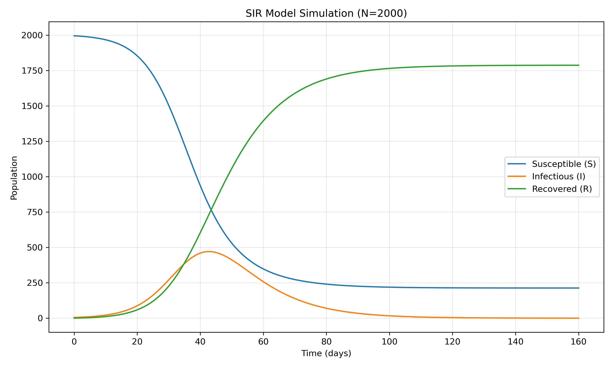
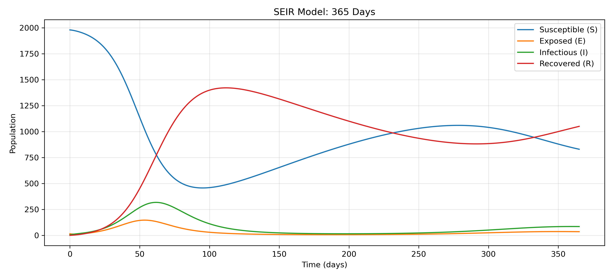
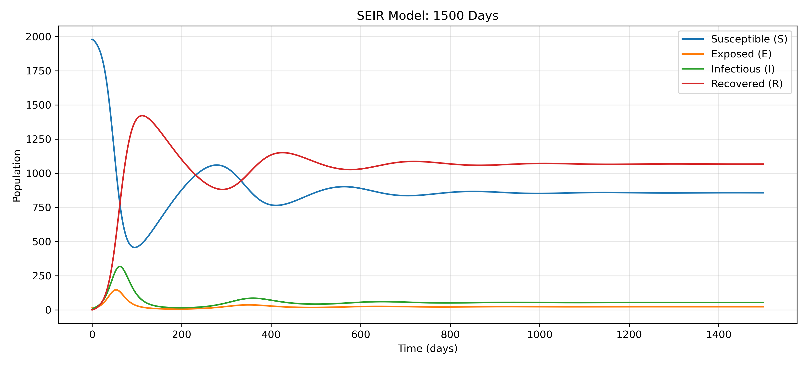
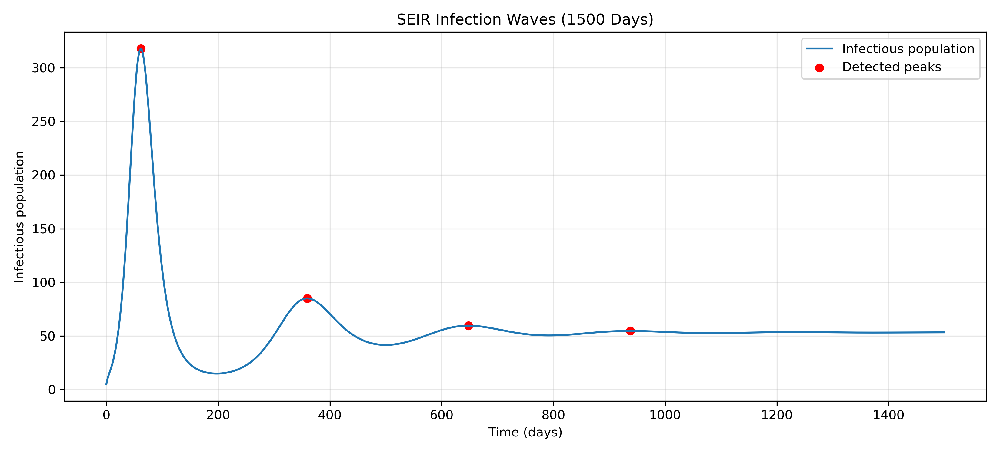
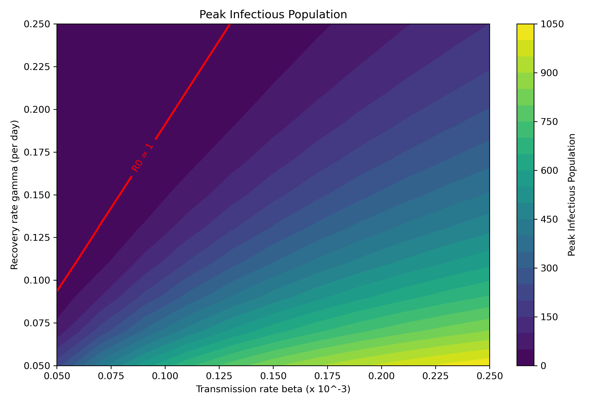
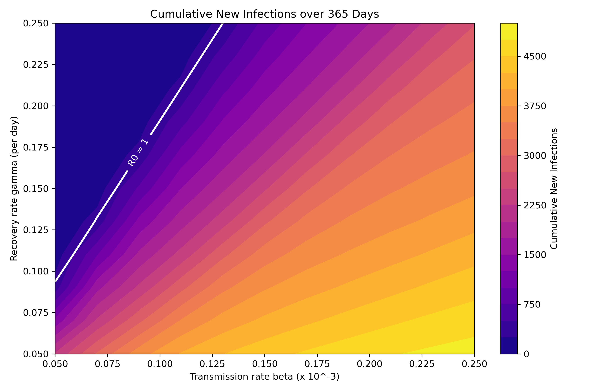

README.md

# BMI 500  - Homework 7

**Name:** Yingchuan Sun
**Email:** [yingchuan.sun@emory.edu](mailto:yingchuan.sun@emory.edu)
**Course:** BMI 500
**Homework:** HW1 – SIR and SEIR Model Implementation for Pandemic Spread


Part A-C: SIR Model Analysis and Interpretation

**C.i Infection Peak**

The maximum infectious population was 470, occurring on day 43. The peak occurs when the transmission rate of new infections equals the recovery rate. The theoretical susceptible population at this point is 800.

**C.ii Basic Reproduction Number**

The basic reproduction number is (R_0=2.5). Since (R_0>1), the infection can spread initially. As the susceptible population decreases, the effective reproduction number falls and eventually reaches 1, corresponding to the infection peak.

**C.iii Epidemic Dynamics**

During the simulation, the susceptible population decreased, the infectious population initially increased and subsequently declined, and the recovered population increased continuously.

By day 160, approximately 213 individuals remained susceptible, while 1788 had experienced infection.

The decline in infections occurs because the susceptible population eventually becomes too small to sustain the initial rate of transmission.



## Part D: SEIR Model with Births and Deaths

I extended the SIR model by introducing an exposed compartment (E) and birth/death processes. 

### Epidemic Waves

Four infection peaks were detected:

| Peak | Day   | Infectious Population |
| ---- | ----- | --------------------- |
| 1    | 61.7  | 317.60                |
| 2    | 359.4 | 85.09                 |
| 3    | 648.0 | 59.66                 |
| 4    | 937.8 | 54.76                 |

The first wave was the largest. Later waves became smaller because the system gradually approached a stable state. Births added new susceptible people, allowing infections to continue.

### Basic Reproduction Number

The SEIR model has (R_0 \approx 2.33), slightly lower than the SIR model ((R_0 = 2.50)).

The theoretical long-term susceptible population is (N/R_0 \approx 856.8). This represents the expected susceptible population at equilibrium.

### Discussion

The exposed group delays the spread of infection. Births add new susceptible people and allow repeated infection waves. Deaths remove people from all groups.

The model uses an average lifespan of 200 days to make the waves easier to observe. With a realistic human lifespan, population changes would be much slower, and later waves would take longer to develop.







## Part E: Sensitivity Analysis

### Parameter Sweep

We tested 11 values of β (0.05–0.25 × 10⁻³) and 11 values of γ (0.05–0.25), for a total of 121 simulations. Each simulation ran for 365 days.

### Results





Both heatmaps show that:

- Higher β leads to more infections and a higher infection peak.
- Higher γ reduces both the infection peak and total new infections.
- When R₀ is below 1, the infection remains at a low level.
- The highest peak is around 1,050 infected people, while cumulative new infections reach approximately 5,000 in the most severe scenarios.

### Discussion

The results show that both β and γ strongly affect epidemic outcomes. The effect of each parameter depends on the value of the other. The heatmaps show why controlling transmission and reducing infectious duration are both important.

The R₀ = 1 line separates parameter settings where infection can initially grow from those where it tends to decline. However, it does not directly predict the total number of infections over 365 days.

## Hypothesis Revisited

**1. Infection Peak (Part B)**

I predicted that infections would peak around day 10. The simulation showed that the peak occurred much later. My prediction underestimated how long the infection takes to spread through the population.

**2. Infection Waves (Part D)**

I predicted several infection waves because the exposed compartment would delay the spread. The simulation showed 4 peaks in total. My prediction was supported, although the repeated waves were also caused by births adding new susceptible people.

**3. Parameter Sensitivity (Part E)**

I predicted that γ would affect the infection peak more than β because γ directly controls recovery. The heatmaps showed that both parameters strongly affect the peak. 

Overall, my hypotheses were partly supported. The simulations helped me better understand how transmission, recovery, exposure, and population changes affect epidemic dynamics.


## AI Statement

ChatGPT GPT-6 has been used to help complete this homework. Conversation Link: https://chatgpt.com/share/6ad29960-adfc-83ea-a576-230f3a980c26


## How to Run

### Requirements

- Python 3.9 or later
- NumPy
- Matplotlib
- SciPy
- Jupyter Notebook

### Installation

Install the required packages:

```
pip install numpy matplotlib scipy notebook
```


